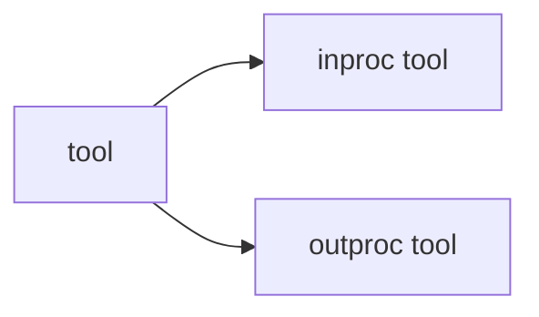
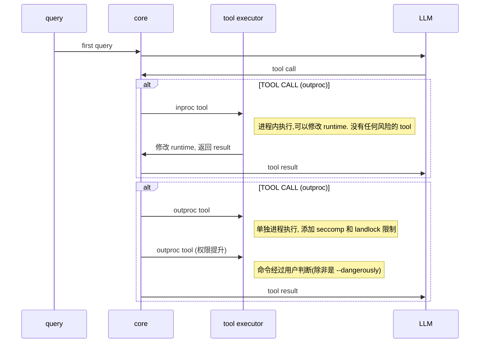

# Agent CLI
使用 golang 实现的 agent cli

## Roadmap
- Client Server 分离 (ACP)
- Client 和 Server 间实现消息队列, 可暂存/撤回消息
- 工具执行中途 append 消息
- [ ] 并行工具执行, 内核级限制, 安全且高性能
  - tool 参数定义 json schema
  - 区分内部 tool 和可插拔 tool
    - 加载 skill 为内部tool, 需要管理 装载 skill content
    - 需要权限控制的放在 可插拔 tool, 在受限环境中执行
  - 代码实现
    - registry 结构
    - executor 分流
    - 不同tool 需要不同参数
    - executor cmd 失败时如何提升权限
- [ ] Skill 渐进式披露/动态卸载
- [ ] 支持 MCP Client
- [ ] 支持作为 MCP server (agent as tool), 支持使用 json 定义暴露能力
- [ ] 支持图片输入
- [ ] TUI
  - [ ] Client command
- [ ] Sub Agent
- [ ] 命名

### draft

